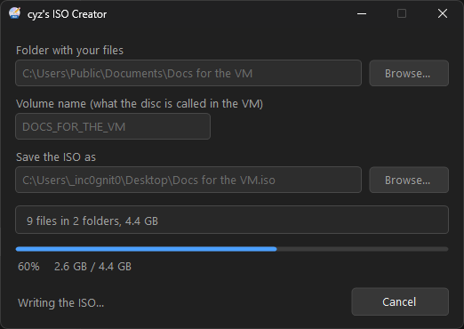
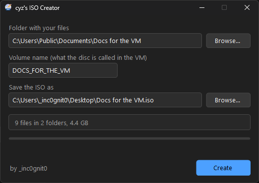
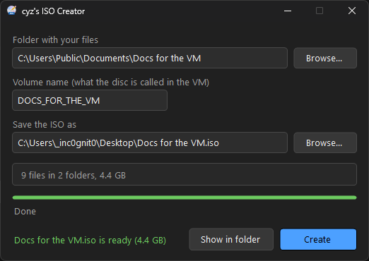

# cyz's ISO Creator

Makes an ISO file from a folder. That's it.

Handy when a virtual machine has no VMware Tools, no shared folders and no network yet: put your documents in a folder, make an ISO, and mount it in the VM as a CD/DVD drive. Works with VMware, VirtualBox, Hyper-V and anything else that takes an ISO - even Windows XP reads it.

**[Download the latest version](https://github.com/cyz-yt/cyzs-ISO-Creator/releases/latest)** · [Website](https://cyzs-retroweb.rf.gd/isocreator.php)

Current version: **1.0**

## What it does

- **Long file names and Polish letters stay as they are.** No `DOKUME~1.DOC`.
- **Files over 2 GB?** The ISO switches to UDF by itself - the summary tells you before you start.
- **Light or dark, just like Windows.** It follows your Windows theme, and switches live when you change it.
- **Never goes online.** No updates, no reports, no accounts. It uses the ISO maker that's built into Windows (IMAPI2), so there's nothing extra inside.
- Cancel any time - the half-made ISO is removed.

## How it works

1. Pick a folder with **Browse...** - or drop one on the window.
2. Check the volume name (that's what the drive is called in the VM) and where the ISO goes. Both are filled in for you.
3. Click **Create**.

## Screenshots

| | |
|---|---|
|  |  |
| Folder picked - files counted before you start | Done - one click shows the ISO in Explorer |

## Installing

Download `IsoCreator-1.0-setup.exe` from [Releases](https://github.com/cyz-yt/cyzs-ISO-Creator/releases/latest) and run it. It installs for you only, no admin needed (or for everyone, if you pick that).

Windows may say "Windows protected your PC" because the installer is not code-signed - click **More info**, then **Run anyway**.

Needs Windows 7 SP1 or newer with .NET Framework 4.7.2 (already there on Windows 10 and 11).

## More from the same author

- [OrkaPlayer](https://github.com/cyz-yt/OrkaPlayer): a media player with lyrics that sing along, karaoke, radio, TV and podcasts.
- [OrkaNote](https://github.com/cyz-yt/OrkaNote): a Notepad for Windows with tabs that come back, colours for code, Run (F9) for scripts and a dark theme.
- [OrkaLinux](https://github.com/cyz-yt/OrkaLinux): a Linux distribution built on Debian 13 with KDE Plasma 6.

Thanks for using cyz's ISO Creator!
