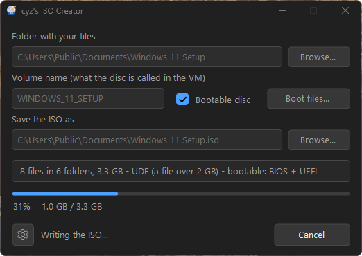
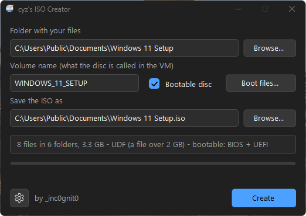
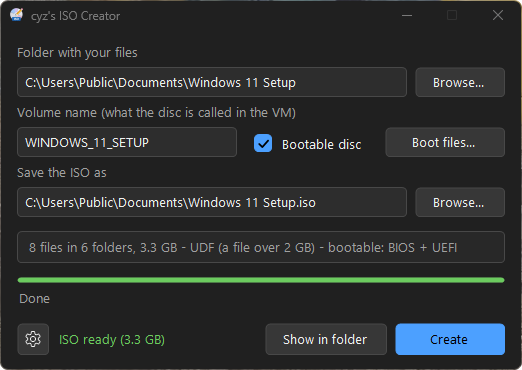
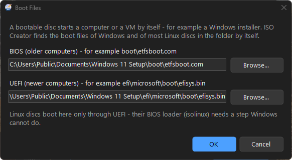
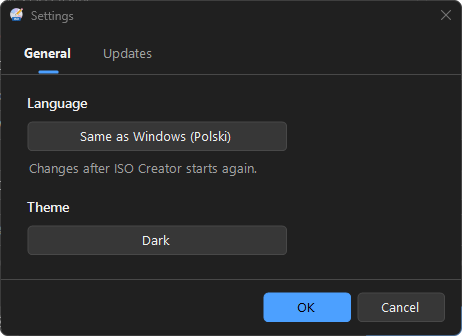

# cyz's ISO Creator

Makes an ISO file from a folder - a plain disc, or a bootable one.

Handy when a virtual machine has no VMware Tools, no shared folders and no network yet: put your documents in a folder, make an ISO, and mount it in the VM as a CD/DVD drive. Works with VMware, VirtualBox, Hyper-V and anything else that takes an ISO - even Windows XP reads it. Since 1.1 it also makes bootable discs, for example from an unpacked Windows installer.

**[Download the latest version](https://github.com/cyz-yt/cyzs-ISO-Creator/releases/latest)** · [Website](https://cyzs-retroweb.rf.gd/isocreator.php)

Current version: **1.1**

## What it does

- **Bootable discs (BIOS and UEFI).** The boot files of Windows and most Linux discs are found in the folder by themselves, or you pick them by hand. Linux boots from such a disc through UEFI.
- **Long file names and Polish letters stay as they are.** No `DOKUME~1.DOC`.
- **Files over 2 GB?** The ISO switches to UDF by itself - the summary tells you before you start.
- **Light or dark.** The same as Windows at first - pick the one you like in Settings.
- **8 languages:** English, Polish, German, Spanish, French, Italian, Portuguese and Ukrainian - Windows language by default.
- **Updates, and nothing else online.** At start it reads a small version file on the website. A new version comes only from this GitHub page and only runs when its SHA-256 matches. Turn it off in Settings. No reports, no accounts. It uses the ISO maker that's built into Windows (IMAPI2), so there's nothing extra inside.
- Cancel any time - the half-made ISO is removed.

## How it works

1. Pick a folder with **Browse...** - or drop one on the window.
2. Check the volume name (that's what the drive is called in the VM) and where the ISO goes. Both are filled in for you. If the folder has boot files, "Bootable disc" gets ticked too.
3. Click **Create**.

## Screenshots

| | |
|---|---|
|  |  |
| Folder picked - files counted, boot files found | Done - one click shows the ISO in Explorer |
|  |  |
| Boot files: BIOS and UEFI | Settings: language, theme and updates |

## Installing

Download `IsoCreator-1.1-setup.exe` from [Releases](https://github.com/cyz-yt/cyzs-ISO-Creator/releases/latest) and run it. It installs for you only, no admin needed (or for everyone, if you pick that).

Windows may say "Windows protected your PC" because the installer is not code-signed - click **More info**, then **Run anyway**.

Needs Windows 7 SP1 or newer with .NET Framework 4.7.2 (already there on Windows 10 and 11).

## More from the same author

- [OrkaPlayer](https://github.com/cyz-yt/OrkaPlayer): a media player with lyrics that sing along, karaoke, radio, TV and podcasts.
- [OrkaNote](https://github.com/cyz-yt/OrkaNote): a Notepad for Windows with tabs that come back, colours for code, Run (F9) for scripts and a dark theme.
- [OrkaPaint](https://github.com/cyz-yt/OrkaPaint): a drawing program for Windows - a bit more than plain Paint, with layers, selections and effects.
- [OrkaLinux](https://github.com/cyz-yt/OrkaLinux): a Linux distribution built on Debian 13 with KDE Plasma 6.
